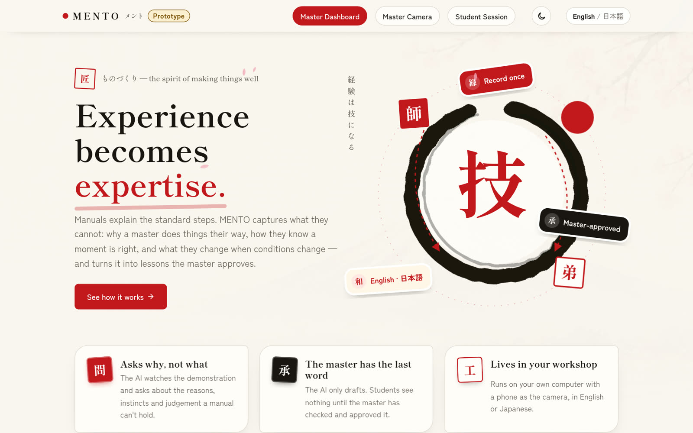
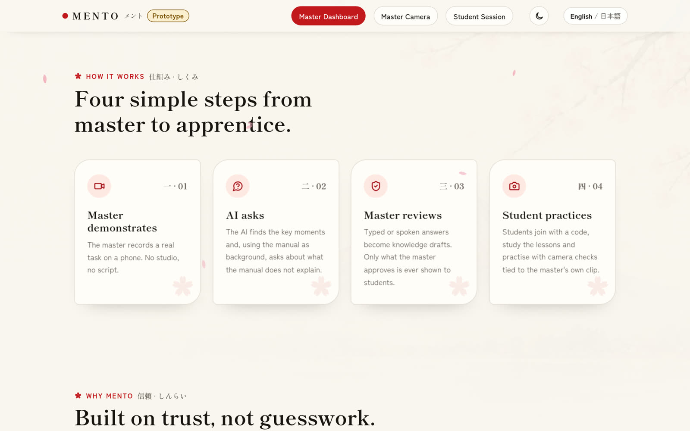
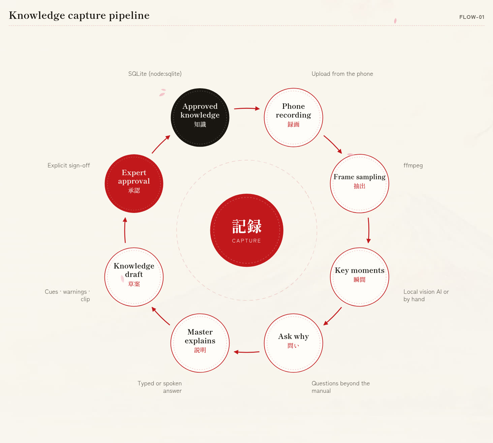
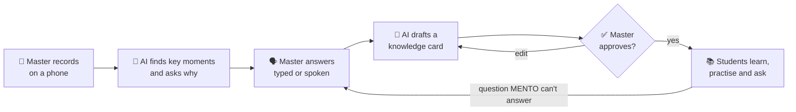
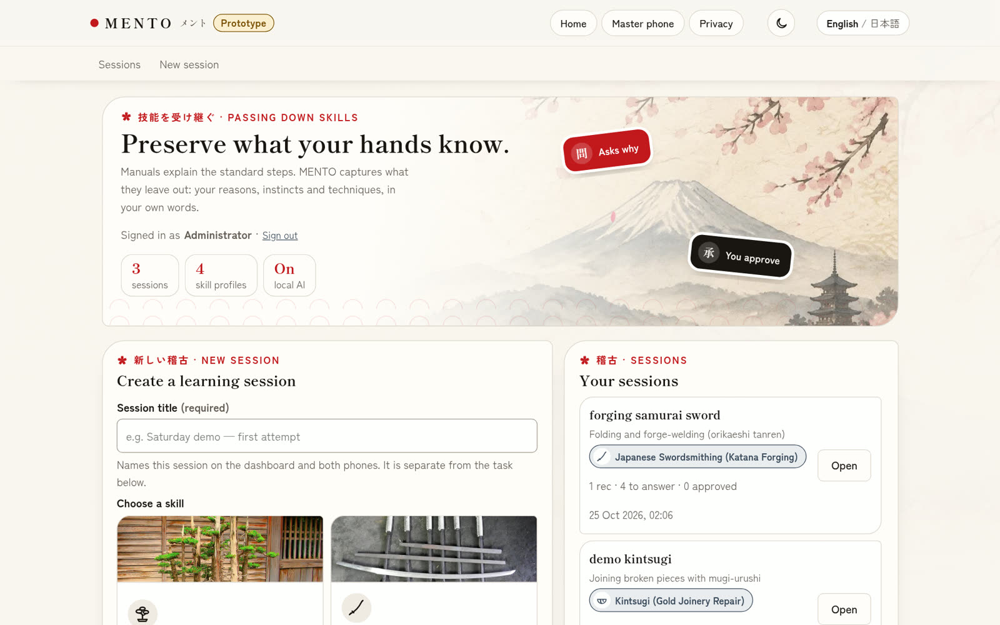
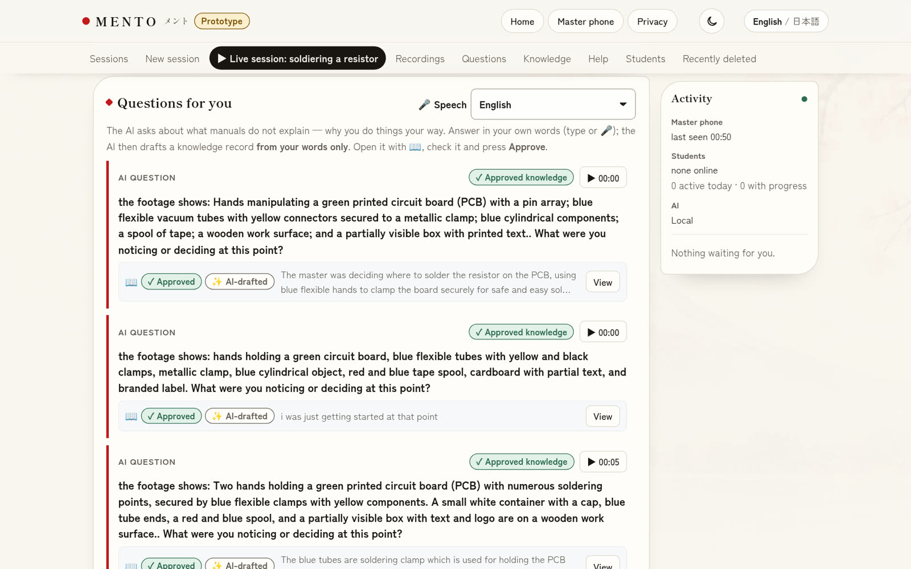
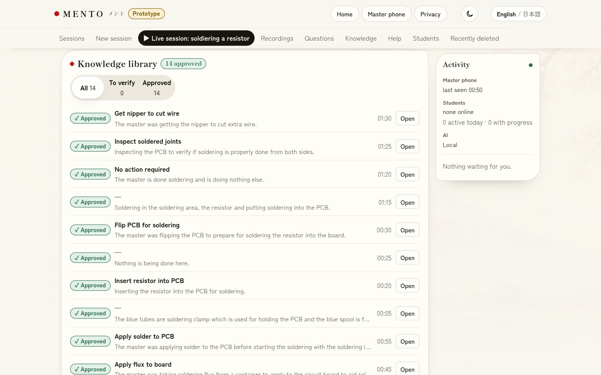
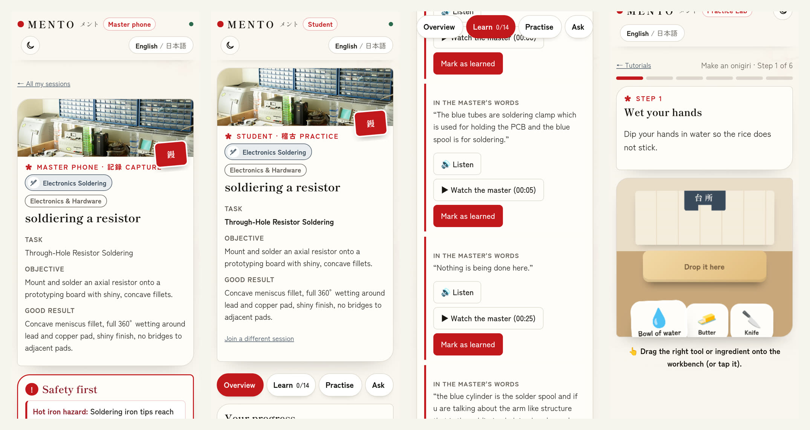
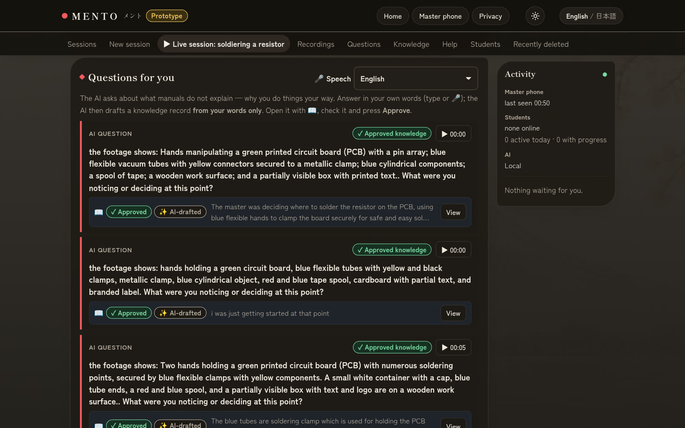

# MENTO メント

**Experience becomes expertise.**

MENTO helps experienced craftspeople pass on what they know — not just the steps, but the *why* behind them.

Built by team **ONIGIRI BENTO** for the **Thapar Japan Hackathon 2026**.

🌐 **Try it live:** <https://52-139-145-196.sslip.io>



---

## The problem

Manuals are good at the standard steps. What they miss is the stuff a master knows without thinking about it:
why they hold the iron *there*, how they can tell the joint is ready, what they change when the wood is wet.
When a master retires, most of that leaves with them.

Asking a master to "write it all down" doesn't work — they don't know what they know.
But if you **watch them work and ask good questions at the right moments**, it comes out naturally.

That's what MENTO does.

## How it works



1. **The master records a real task on their phone.** No studio, no script. They can also upload a video they filmed before.
2. **The AI watches the video and asks questions.** It finds the key moments and asks about the things a manual doesn't explain — *"Why did you wait two seconds here?"*
3. **The master answers in their own words**, by typing or just speaking (English or Japanese). The AI turns each answer into a short knowledge card, and the master checks it and approves it.
4. **Students learn from the approved cards.** They join with a 6-character code, watch the master's clip for each step, listen to the tips read aloud, check their own work with the camera, and ask questions. If MENTO doesn't know the answer, the question goes straight to the master.

The important rule: **students only ever see what the master has approved.** The AI drafts, the master decides.

Here's the full loop, as shown on the website:





## What it looks like

MENTO has three screens, one for each person in the room.

### 1. Master dashboard (laptop)

Where the master creates sessions, answers the AI's questions, and approves knowledge.



The AI's questions sit next to the moment in the video they came from. Answer by typing or with the 🎤 button:



Every approved answer ends up in the knowledge library:



### 2. Master camera and 3. Student phone

From left to right: the master's phone, the student's overview, the lessons (with *Listen* and *Watch the master*), and the **Practice Lab**, a small browser game where students practise the steps by dragging the right tool onto the workbench.



### Dark mode

Every page has a light/dark switch and an **English / 日本語** switch.



## Features

- 🎥 **Record or upload** — record on the phone, or upload an existing video (MP4, MOV, WebM, MKV).
- 🤖 **Questions that go beyond the manual** — the AI is given the standard manual for the craft and told *not* to ask about it, so it focuses on the master's own judgement.
- 🗣️ **Talk instead of typing** — spoken answers are transcribed on the machine running MENTO (Whisper), in English or Japanese.
- 🇯🇵 **Fully bilingual** — the whole interface switches between English and Japanese, and the AI can ask its questions in natural, polite Japanese.
- 🔊 **Read aloud** — students can listen to every tip in the language the site is set to (Japanese voice: Open JTalk).
- ✅ **The master has the final word** — nothing reaches students until it's approved.
- 📷 **Check my work** — students take a photo, and MENTO compares it with the master's approved advice.
- 🙋 **Ask the master** — questions MENTO can't answer go to the master, and replies show up live on the student's phone.
- 🎮 **Practice Lab** — a lightweight, browser-based practice simulation built from the master's lessons (plus a fun onigiri-making demo).
- 🗑️ **Recently deleted** — deleted items can be restored for 7 days.
- 🌗 **Light and dark mode** on every page.

Skills included out of the box: **electronics soldering, bonsai, kintsugi** and **Japanese swordsmithing**. A master can also describe any other skill when creating a session.

## Privacy

MENTO was designed to run on your own computer.

- By default, **everything stays local**: videos, audio, the AI model, and the database.
- Students and masters must agree to a clear consent screen before anything is recorded.
- Video links expire after a few minutes, and passwords are stored hashed.
- There's an optional "hybrid" mode that can send *text only* (never video) to a cloud AI for better results. It's off unless the operator turns it on, and the privacy pages update to say so.

## Run it yourself

You'll need **Node.js 22.13 or newer**.

```bash
git clone https://github.com/thakurAarusH/mento.git
cd mento
npm install
cp .env.example .env     # then open .env and set MASTER_PASSPHRASE
npm start
```

Open <http://localhost:3000>. That's enough to try the whole flow — you can add the key moments yourself instead of using the AI.

To get the full experience, install the optional local tools:

| Tool | What it adds |
|---|---|
| [Ollama](https://ollama.com) + `qwen3-vl:4b-instruct` and `ffmpeg` | AI video analysis and question writing |
| [whisper.cpp](https://github.com/ggml-org/whisper.cpp) + `ggml-small-q5_1.bin` | Spoken answers (speech to text) |
| Open JTalk + the "Mei" voice, `espeak-ng` | Read-aloud in Japanese and English |

Phones need **HTTPS** to use the camera and microphone. The easiest free way is a Cloudflare quick tunnel:
`cloudflared tunnel --url http://localhost:3000`.

Run the tests with `npm test` (95 tests).

👉 Setup details, every setting, the hybrid AI mode, and troubleshooting: **[docs/TECHNICAL.md](docs/TECHNICAL.md)**
👉 Putting MENTO on a server: **[deploy/oracle/README.md](deploy/oracle/README.md)**

## How it's built

Deliberately simple, so it costs nothing to run:

- **Server:** Node.js + Express, plain JavaScript, no build step
- **Database:** SQLite (built into Node), with videos stored as files
- **AI:** Ollama with the Qwen3-VL vision model, running locally
- **Speech:** whisper.cpp for speech-to-text, Open JTalk and espeak-ng for read-aloud
- **Live updates:** Server-Sent Events
- **Front end:** HTML, CSS and JavaScript, with self-hosted Japanese fonts

```
app.js            all the routes and business logic
lib/              AI, cloud AI, skills, legal pages
public/           the website: landing page, dashboard, phones, Practice Lab
skills/           the built-in craft profiles (English + Japanese)
test/             automated tests
deploy/oracle/    one-command server installer
docs/             technical guide, API reference, compliance notes
```

## About the live demo

The live site runs on a small free student server (Azure for Students). Because that server has only 1 GB of memory, the AI video analysis is switched off there. Everything else works, including the sessions and knowledge already recorded. For the full AI experience, run MENTO on a laptop as above.

## Team

**ONIGIRI BENTO** 🍙 — Thapar Japan Hackathon 2026

## Credits

- Japanese voice: HTS voice "Mei" © Nagoya Institute of Technology (CC BY 3.0)
- Skill photos: credited on the site and in `public/common.js`
- See [docs/COMPLIANCE.md](docs/COMPLIANCE.md) for licences, costs and accessibility notes
