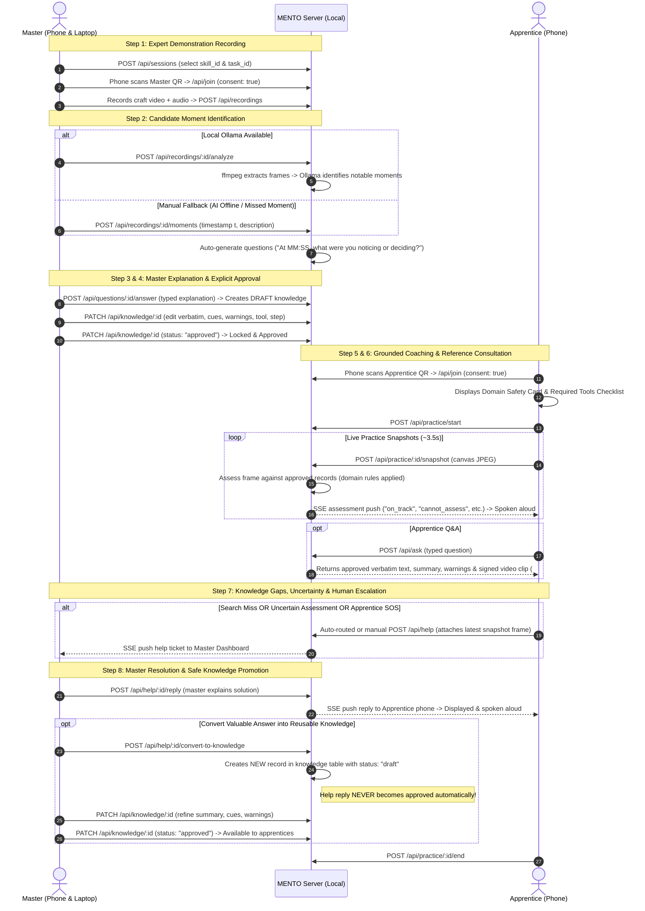

# MENTO — Full Workflow API Contract & Generalisation Specification

**Product Name:** MENTO
**Tagline:** Experience becomes expertise.
**Version:** 0.2.0 (Final Prototype Specification)
**Target Repository:** `https://github.com/thakurAarusH/mento`
**Shared Integration Branch:** `mento` (all work branches off `mento` and merges back into `mento`)
**Initial Domains:** Electronics Soldering & Bonsai Cultivation
**Architecture:** Zero-cost, local-first Node.js 22 + SQLite + vanilla HTML/CSS/JS (no cloud dependencies, no paid APIs)

---

## 0. Contract Changes Developer B Must Apply Before Integrating the UI

These backend changes on `feature/skill-engine` alter response shapes the frontend reads:

1. **`clip` may be `null`** in `GET /api/knowledge` items and `POST /api/ask` answers. Knowledge converted from a help reply has no linked recording, so no video is offered. Render the "Play master's clip" control only when `clip` is an object; never read `clip.url` / `clip.t` unguarded. (The current `public/a.js` reads `a.clip.t` unconditionally and must be updated.)
2. **`POST /api/help/:id/convert-to-knowledge` 409 responses now carry a `code`:** `already_converted` (includes `knowledgeId`, as before) or `help_rejected` (new: rejected tickets cannot be converted). Show `error` and hide/disable "Convert to draft" for rejected tickets.
3. **`409 skill_profile_unavailable`** on `POST /api/join` and `POST /api/practice/start` (see those endpoints).
4. **`POST /api/sessions`** returns the resolved `task` and `procedure`, and fills them from the task template when omitted (see that endpoint).

---

## 1. Feature Implementation Status Matrix

To maintain prototype integrity and academic honesty, every subsystem is classified into one of three explicit categories:

### Category 1: Existing Features Verified by Automated Tests (`npm test`)
- **Master Passphrase Authentication & Rate Limiting:** Single-passphrase authentication (`/api/login`) with HMAC-signed cookie (`mz`) and IP-based rate limiting (8 attempts/minute).
- **Session Lifecycle & Isolation:** Creation (`/api/sessions`), role token minting (192-bit base64url, 24h TTL), token rotation (`/api/sessions/:id/rotate`), session deletion cascading to files and SQLite rows. Cross-session access is blocked.
- **Role-Scoped Access Control & Consent Gating:** Master endpoints require `mz` cookie; phone endpoints require role tokens (`x-token`). Device recording and snapshot uploads are rejected until an unticked consent checkbox is explicitly submitted (`/api/join`).
- **Video Upload Validation:** Binary validation on `/api/recordings` ensuring allowed MIME types (`video/mp4`, `video/webm`, `video/quicktime`), magic byte inspection, and upload size limits.
- **Manual Moment Fallback & Question Generation:** Manual timestamp insertion (`/api/recordings/:id/moments`) creating observation records and structured questions ("At MM:SS — ... What were you noticing or deciding?").
- **Honest AI Fallback:** `/api/recordings/:id/analyze` returns HTTP 503 ("No local vision model configured") when Ollama is offline or unconfigured, without fabricating moments.
- **Draft Knowledge Authoring & Explicit Approval Gate:** Answering a question creates a `draft` record. Content edits to approved records automatically revert them to `draft`. Apprentices can only fetch `status: 'approved'` records.
- **Signed Expiring Media Links:** Private file access via `/f/:kind/:id?exp=...&sig=...` enforcing HMAC verification and expiration checks; tampering and expired tokens are rejected.
- **Keyword Q&A Search & Reference Playback:** `/api/ask` tokenizes apprentice queries and ranks approved knowledge records, returning verbatim text, summary, warnings, and — only for records captured from a recording — a timestamped video link (`clip.url + '#t=' + t`); `clip` is `null` otherwise.
- **Automated Help Escalation on Search Miss:** When `/api/ask` finds zero approved records, it automatically creates a `help` ticket for the master.
- **Snapshot Rate Limiting & Safety Stop Rules:** Practice snapshots are throttled. Ungrounded issues without an approved knowledge citation are automatically downgraded to `cannot_assess` with human escalation. `safety_stop` forces apprentice halt and opens a help request.
- **Help Discussion & Resolution:** Master can reply to apprentice help requests (`/api/help/:id/reply`) and update statuses (`pending`, `answered`, `resolved`, `rejected`, `escalated`).
- **Zero External Resource Leaks:** Automated assertion confirms no external CDNs, fonts, or tracking URLs exist in `public/`.

### Category 2: Existing Code in Source but NOT Verified in Physical Devices or Live AI
- **Ollama Video Analysis Pipeline (`analyzeRec`):** Slices video via `ffmpeg` into 24 frames (1 frame every 5s) and prompts a local Ollama vision model (`OBS` prompt) to identify notable moments. *(Unverified: build environment lacks GPU and vision weights).*
- **Live Ollama Apprentice Assessment (`assess`):** Prompts a local vision model with JPEG frames and approved knowledge records. *(Unverified: requires live vision model).*
- **Server-Sent Events (SSE) Live Multi-Client Push:** `/api/stream` heartbeat and event dispatch written, but live concurrent delivery across mobile and desktop browsers is unverified by automated tests.
- **Physical Mobile MediaRecorder Encoding:** `m.js` video and audio capture via browser `getUserMedia` and `MediaRecorder` chunk assembly. *(Unverified on real mobile hardware).*
- **Apprentice Snapshot Capture Loop:** `a.js` HTML5 canvas downsampling to 640px JPEG under 400 KB. *(Unverified on mobile Safari/Chrome).*
- **Web Speech API Feedback Voice:** `a.js` invocation of `speechSynthesis.speak()`. *(Unverified in automated browser tests).*
- **Automated 30-Day Retention Purge Timer:** `setInterval(purge, 36e5)` in `app.js` runs every hour, but its timer lifecycle is untested.

### Category 3: Features to Be Implemented for Multi-Skill Milestone
- **Declarative Skill Profiles (`skills/*.json`):** Static manifests for `soldering` and `bonsai` defining tools, safety advisories, default tasks, and vision rules.
- **Skill Engine Endpoints:** `GET /api/skills` and `GET /api/skills/:id`.
- **Minimal Safe Schema Migration:** Non-destructive SQLite migration adding only `skill_id` and `task_id` to `sessions`.
- **Dynamic AI Assessment Prompting:** Parameterizing vision rules per domain (`skill.assessment_rules`) to eliminate hard-coded soldering assumptions.
- **Dedicated Unresolved-Knowledge Queue & Safe Promotion:** Endpoint `POST /api/help/:id/convert-to-knowledge` enabling masters to promote useful help answers into `draft` knowledge records for explicit review and approval.
- **Multi-Skill UI Components:** Dashboard skill/task selector, apprentice safety card, and mobile task briefs.

---

## 2. The Complete 8-Step MENTO Workflow



---

## 3. Detailed REST API Contracts

### A. Skills & Domain Profiles

#### `GET /api/skills`
- **Description:** Retrieve available skill domains.
- **Access:** Public
- **Response `200 OK`:**
```json
{
  "skills": [
    {
      "id": "soldering",
      "name": "Electronics Soldering",
      "category": "Electronics & Hardware",
      "description": "Through-hole and wire soldering techniques for reliable electrical connections.",
      "taskCount": 2,
      "toolCount": 5
    },
    {
      "id": "bonsai",
      "name": "Bonsai Cultivation & Wiring",
      "category": "Living Craft & Horticulture",
      "description": "Branch wiring, structural pruning, and deadwood refinement for miniature tree styling.",
      "taskCount": 2,
      "toolCount": 5
    }
  ]
}
```

#### `GET /api/skills/:id`
- **Description:** Retrieve complete profile manifest for a specific skill domain.
- **Access:** Public
- **Parameters:** `:id` (`soldering` | `bonsai`)
- **Response `200 OK`:** Full skill profile JSON (see Section 5 for schemas).
- **Response `404 Not Found`:** `{"error": "Skill profile not found."}` — returned for unknown ids and for any id that is not 1–64 characters of `a-z`, `0-9`, `_`, `-` (so encoded path-traversal such as `..%2F..%2Fpackage` never reaches a lookup). The requested id is not echoed back. Profiles are served only from the in-memory registry loaded at startup; the id is never used to build a file path.

---

### B. Session Management

#### `POST /api/sessions`
- **Description:** Master creates a new craft session associated with a skill domain and optional task template.
- **Access:** Master only (`mz` cookie)
- **Request Body (template defaults — recommended for new clients):**
```json
{
  "title": "Bonsai Wiring — Juniper Secondary Branch",
  "skill_id": "bonsai",
  "task_id": "secondary_branch_wiring"
}
```
- **Request Body (explicit custom text — still supported):**
```json
{
  "title": "Bonsai Wiring — Juniper Secondary Branch",
  "skill_id": "bonsai",
  "task_id": "secondary_branch_wiring",
  "task": "Wire the lower-left secondary branch only",
  "procedure": "1. Anchor wire around trunk.\n2. Wind at 45° angle.\n3. Bend branch into position."
}
```
- **Validation:**
  - `title`: Required string, 1–120 characters.
  - `skill_id`: Optional string matching a loaded profile. Omitted, `null` or `""` defaults to `"soldering"`.
  - `task_id`: Optional string matching a task `id` in that profile's `tasks`. Omitted, `null` or `""` means no template (`task_id: null`).
  - `task`, `procedure`: Optional strings. Any non-string, non-null value (number, array, object) returns HTTP 400; the same applies to a non-string `skill_id` / `task_id`.
  - Length: `task` is stored up to 1000 characters and `procedure` up to 4000; longer text is truncated (unchanged legacy behaviour, kept so existing clients are not rejected).
- **Backend-owned task defaults:** the server resolves the selected task from the validated profile.
  - If `task` is omitted, `null`, empty or whitespace-only, it is set to the task template's `title`.
  - If `procedure` is omitted, `null`, empty or whitespace-only, it is set to the template's `default_procedure`.
  - A non-empty explicit value always takes precedence, independently per field (e.g. a custom `task` with the template `procedure`).
  - With no `task_id`, there is no template: omitted fields are stored as `""` (legacy behaviour).
  - The frontend therefore does not need to copy template text into the request; it should send `task` / `procedure` only when the master has typed custom text.
- **Response `201 Created`:** includes the resolved, stored text so the client can display it without a second request.
```json
{
  "id": "7f8b92c4a1e3d509",
  "skill_id": "bonsai",
  "task_id": "secondary_branch_wiring",
  "task": "Secondary Branch Structural Wiring",
  "procedure": "1. Select wire diameter approximately 1/3 the thickness of the branch at its base.\n2. ..."
}
```
- **Response `400 Bad Request`:** `{"error": "..."}` for a missing title, a non-string field, an unknown `skill_id` or a `task_id` not in that skill.

#### `POST /api/join`
- **Description:** Device connects with token, provides active consent, and receives session and skill configuration.
- **Access:** Device token (`x-token` header or query string `?t=`)
- **Request Body:** `{"consent": true}`
- **Validation & order of checks** (nothing is written until every check passes):
  1. Token must exist and be unexpired → otherwise `401`.
  2. `consent === true` is mandatory → unticked/false returns `400`.
  3. The session must exist → otherwise `404`.
  4. The session's skill profile must be loaded → otherwise `409 skill_profile_unavailable` (below).
  5. Only then is consent recorded on the token (`consented_at`, `last_seen`) and a `device_joined` event logged.
- **Legacy sessions:** rows created before skill profiles existed have `skill_id = 'soldering'` (migration default) and `task_id: null`; a `NULL` `skill_id` is also treated as `soldering`. These join normally. Any other `skill_id` is never substituted.
- **Response `200 OK`:** (actual response for a bonsai session created from the `secondary_branch_wiring` template; every tool keeps `id`, `name` and `purpose`)
```json
{
  "role": "apprentice",
  "session": {
    "title": "Bonsai Wiring — Juniper Secondary Branch",
    "task": "Secondary Branch Structural Wiring",
    "procedure": "1. Select wire diameter approximately 1/3 the thickness of the branch at its base.\n2. Anchor the wire firmly around the main trunk or an opposing branch (minimum 1.5 anchor turns).\n3. Wind the wire along the branch at a steady 45° angle with even spacing.\n4. Ensure wire contacts the bark snugly without crushing it or trapping green foliage.\n5. Support the branch with both hands while applying gentle, steady bending pressure.\n6. Check branch holds new position without springing back or splitting at the junction.",
    "skill_id": "bonsai",
    "task_id": "secondary_branch_wiring"
  },
  "skill": {
    "id": "bonsai",
    "name": "Bonsai Cultivation & Wiring",
    "safety_advisories": [
      "Sharp cutter hazard: Concave branch cutters are razor-sharp; keep fingers clear of cutting jaws.",
      "Branch fracture risk: Bending stiff lignified branches too fast can snap structural wood.",
      "Cambium protection: Wires wound too tight will bite into growing tree bark and leave permanent scars.",
      "Eye hazard: Aluminum/copper wire ends can whip back unexpectedly when cutting or uncoiling."
    ],
    "tools": [
      {
        "id": "concave_cutter",
        "name": "Concave Branch Cutter",
        "purpose": "Trimming branches flush with trunk to form a sunken healing wound"
      },
      {
        "id": "aluminum_wire",
        "name": "Anodized Aluminum Wire (1.5mm–3.5mm)",
        "purpose": "Shaping branch direction and angle"
      },
      {
        "id": "jin_pliers",
        "name": "Jin Pliers",
        "purpose": "Gripping and bending wire ends, and creating deadwood"
      },
      {
        "id": "wire_cutters",
        "name": "Bonsai Wire Cutters",
        "purpose": "Cutting wire close to bark without damaging cambium"
      },
      {
        "id": "wound_sealant",
        "name": "Cut Paste / Wound Sealant",
        "purpose": "Protecting exposed cuts from drying and rot"
      }
    ]
  },
  "limits": {
    "maxVideoMb": 200,
    "maxRecSec": 600,
    "snapshotMs": 3500,
    "maxFrameKb": 400
  }
}
```
- **Response `409 Conflict` — skill profile unavailable:** the session references a `skill_id` whose manifest is not loaded on this server (file removed, renamed or failing validation).
```json
{
  "error": "This session's skill profile is unavailable on the server, so its safety guidance cannot be shown. Ask the master to check the installation or create a new session.",
  "code": "skill_profile_unavailable"
}
```
  - The invitation token, consent state and event log are left untouched, so the same QR code works again once the profile is restored.
  - **Frontend handling:** treat `409` + `code: "skill_profile_unavailable"` as a blocking error. Do not proceed to the recording/practice screens, do not show a generic or cached safety card, and display `error` to the user (the existing `api()` helper already throws with `error` as the message). Offer "try again" rather than "rescan"; the token is still valid.

---

### C. Media Recording & Candidate Moments

#### `POST /api/recordings`
- **Description:** Master phone uploads recorded demonstration video (includes audio track).
- **Access:** Master token (`x-token`), consented device.
- **Headers:** `content-type: video/mp4` | `video/webm` | `video/quicktime`
- **Body:** Raw binary video buffer (up to `MAX_VIDEO_MB`, default 200 MB).
- **Validation:** Checks declared MIME against magic bytes (`ftyp` for MP4/MOV, `\x1a\x45\xdf\xa3` for WebM).
- **Response `201 Created`:** `{"id": "a1b2c3d4e5f60718"}`

#### `POST /api/recordings/:id/analyze`
- **Description:** Trigger local Ollama video analysis on master recording.
- **Access:** Master only (`mz` cookie)
- **Response `202 Accepted`:** `{"ok": true}` (Analysis running in background; emits SSE events).
- **Response `503 Service Unavailable`:** `{"error": "No local vision model configured (set OLLAMA_URL and OLLAMA_VISION_MODEL). Add moments manually instead."}`

#### `POST /api/recordings/:id/moments`
- **Description:** Manual moment fallback: master scrubs video on dashboard and records an observation at timestamp `t`.
- **Access:** Master only (`mz` cookie)
- **Request Body:**
```json
{
  "t": 48,
  "text": "The aluminum wire is anchored around the trunk with two tight 45-degree loops before proceeding up the secondary branch."
}
```
- **Response `201 Created`:** `{"ok": true}` (Automatically creates a question: *"At 00:48 — ... What were you noticing or deciding at this point?"*).

#### `GET /f/:kind/:id`
- **Description:** Stream private recording or snapshot file via HMAC-signed, expiring URL.
- **Access:** Public with valid `exp` (timestamp) and `sig` (HMAC-SHA256 signature).
- **Query Params:** `?exp=1792750000000&sig=abcdef012345...`
- **Response `200 OK`:** Raw binary file with `Cache-Control: private, no-store`.
- **Response `403 Forbidden`:** Expired or tampered link.

---

### D. Knowledge Authoring, Verification & Approval

#### `POST /api/questions/:id/answer`
- **Description:** Master inputs their typed explanation answering the "why?" question for a detected or manual moment.
- **Access:** Master only (`mz` cookie)
- **Request Body:**
```json
{
  "text": "I anchor the wire around the main trunk twice so that when I apply bending force to the branch, the wire doesn't slip or twist the bark."
}
```
- **Response `201 Created`:** `{"id": "k192a83fbc740112"}` (Creates record in `knowledge` table with `status: 'draft'`).

#### `PATCH /api/knowledge/:id`
- **Description:** Master reviews, structures, edits, and explicitly approves or rejects a knowledge record.
- **Access:** Master only (`mz` cookie)
- **Request Body:**
```json
{
  "verbatim": "I anchor the wire around the main trunk twice so that when I apply bending force to the branch, the wire doesn't slip or twist the bark.",
  "summary": "Anchor wire with two firm turns on the primary trunk before bending secondary branches.",
  "cues": "Anchor point feels rigid; wire does not rotate when tugged lightly.",
  "warnings": "Do not cross wires on the trunk; ensure no leaves are trapped beneath the anchor turns.",
  "step": "anchor wire",
  "tool": "aluminum_wire",
  "status": "approved"
}
```
- **Validation:**
  - `status`: Must be one of `draft`, `approved`, `rejected`, `clarify`.
  - Approval check: `status === 'approved'` requires non-empty `verbatim` text.
  - Reset rule: Any text modification to an already `approved` record automatically resets status to `draft` unless explicitly approved in the same request.
- **Response `200 OK`:** `{"ok": true, "status": "approved"}`

#### `GET /api/knowledge`
- **Description:** Retrieve knowledge records for the current session.
- **Access:** Master (`mz` cookie) sees all records (`draft`, `approved`, `rejected`). Apprentice (`x-token`) receives ONLY `status: 'approved'` records.
- **Query Params:** `?q=anchor` (optional keyword search).
- **Response `200 OK`:** Array of knowledge records. Each has `clip`: either `{ "url": "/f/rec/<id>?exp=…&sig=…", "t": <seconds> }` or `null`.
- **When `clip` is set:** only if the record genuinely originates from a recording — its `recording_id` is non-empty, refers to a recording in the same session, and the record was not converted from a help reply. Records answered from a video moment (`POST /api/questions/:id/answer`) keep their signed, timestamped clip.
- **When `clip` is `null`:** help-derived knowledge (a typed reply is not evidence from any recording), including records converted before this rule existed that point at an unrelated recording. The server never substitutes another session recording.

---

### E. Apprentice Coaching & Inquiry

#### `POST /api/practice/start`
- **Description:** Apprentice begins practice run.
- **Access:** Apprentice token (`x-token`), consented.
- **Response `201 Created`:** `{"id": "p8812c3f4a9b0011"}`
- **Response `409 Conflict`:** `{"error": "...", "code": "skill_profile_unavailable"}` if the session's skill profile has become unavailable after the device joined. No practice row is created. Frontend handling is the same as for `/api/join`.

#### `POST /api/practice/:id/snapshot`
- **Description:** Apprentice phone sends camera frame snapshot for visual check.
- **Access:** Apprentice token (`x-token`), consented.
- **Query Params:** `?manual=1` (set when apprentice explicitly taps "Check my work").
- **Body:** Binary JPEG buffer (< 400 KB).
- **Response `202 Accepted`:** `{"queued": true}` (Result dispatched via SSE).
- **Rate Limit Response:** `{"queued": false, "reason": "rate limited"}` (Throttled if sent faster than snapshot interval).
- **Missing skill profile:** if the session's profile is unavailable when a snapshot is assessed, the server does **not** call the vision model and does not fall back to another skill's rules. It stores and pushes `{"status": "cannot_assess", "confidence": "low", "knowledge_ids": [], "needs_help": true, "source": "rule", "feedback": "Automatic check unavailable: this session's skill profile is missing, so no domain safety rules can be applied. Asking the master."}` and opens a help request for the master (once per practice while a ticket is `pending`/`answered`, using the existing duplicate-ticket guard), including for automatic (non-manual) snapshots.
- **AI unavailable:** with a valid profile but no local vision model, the honest `cannot_assess` / `source: "unavailable"` fallback is unchanged.

#### `POST /api/ask`
- **Description:** Apprentice searches approved knowledge using natural language question.
- **Access:** Apprentice token (`x-token`), consented.
- **Request Body:** `{"text": "How tightly should I wrap the wire?"}`
- **Response `200 OK` (Approved Match Found):**
```json
{
  "answers": [
    {
      "id": "k192a83fbc740112",
      "step": "wire branch",
      "verbatim": "Maintain a 45-degree angle. The wire should touch the bark snugly with zero daylight, but never pinch or crush the living tissue.",
      "summary": "Wind wire at 45° with firm contact but zero bark indentation.",
      "warnings": "Do not cross wires; crossing creates pressure points that scar wood.",
      "clip": {
        "url": "/f/rec/a1b2c3d4e5f60718?exp=1792750000000&sig=abc...",
        "t": 48
      }
    }
  ],
  "helpRequested": false
}
```
- **`clip`:** same rule as `GET /api/knowledge` — `null` for help-derived answers, e.g. `{"id": "k8810e42ab012984", "step": "", "verbatim": "No. Dormant dry branches are brittle…", "summary": "", "warnings": "", "clip": null}`. The UI must not show a play button for these.
- **Response `200 OK` (Knowledge Gap — Search Miss):**
```json
{
  "answers": [],
  "helpRequested": true
}
```
*(When no match exists, MENTO automatically opens a pending ticket in the Unresolved Knowledge queue and notifies the master via SSE).*

---

### F. Dedicated Unresolved-Knowledge Queue & Safe Promotion

#### `POST /api/help`
- **Description:** Apprentice requests direct master intervention (or triggered automatically on search miss).
- **Access:** Apprentice token (`x-token`), consented.
- **Request Body:** `{"question": "The branch feels very stiff and is creaking when I bend it. Should I stop?"}`
- **Behavior:** Attaches the latest practice snapshot frame to the help request.
- **Response `201 Created`:** `{"id": "h9912a77bc401234"}`

#### `GET /api/help`
- **Description:** Retrieve help tickets and master replies.
- **Access:** Apprentice (`x-token`) receives own session tickets. Master (`mz` cookie) views all tickets across the session.
- **Response `200 OK`:** Array of help items with status (`pending`, `answered`, `resolved`, `rejected`, `escalated`), attached snapshot frame link, and thread replies.

#### `POST /api/help/:id/reply`
- **Description:** Master replies to the apprentice with practical advice.
- **Access:** Master only (`mz` cookie)
- **Request Body:**
```json
{
  "text": "Stop bending immediately. When you hear creaking, the lignified heartwood is beginning to split. Apply raffia or self-fusing silicone tape tightly over the stress point before attempting any further movement."
}
```
- **Response `201 Created`:** `{"ok": true}` (Apprentice phone receives reply via SSE; displays and speaks response aloud).

#### `POST /api/help/:id/convert-to-knowledge`
- **Description:** Master promotes a valuable help answer into a reusable draft knowledge record.
- **Access:** Master only (`mz` cookie)
- **Request Body:** *(Empty or optional overrides)*
- **Safety Workflow Rules:**
  1. Locates help ticket. If already converted → `409 already_converted`. If its status is `rejected` → `409 help_rejected` (nothing written). If it has no master reply → `400`.
  2. Uses the latest master reply. **No recording is attached:** a typed reply is not evidence that any session recording demonstrates the answer.
  3. Inserts a new row into `knowledge` using existing schema columns:
     - `session_id`: Ticket's session.
     - `question_id`: the help request's ID (reused as the link back to the ticket; see limitation below).
     - `recording_id`: `""` (the column is `NOT NULL`; empty means "no linked recording"). Consequently the record's `clip` is `null` in every response.
     - `t`: 0.
     - `observed`: Ticket's question text.
     - `verbatim`: Master's reply text.
     - `summary`: `""` (to be filled by master during review).
     - `cues`: `""` (to be filled by master).
     - `warnings`: `""` (to be filled by master).
     - `step`: Ticket's step or `""`.
     - `tool`: `""`.
     - `status`: `'draft'` (**STRICT: Never automatically approved**).
     - `approved_at`: `null`.
     - `created_at`: `now()`.
  4. Updates help ticket status to `'resolved'`.
  5. Logs a `knowledge_draft_from_help` event and pushes a `help` SSE update to the dashboard.
- **Access errors:** without the master cookie (including with an apprentice or master *device* token) → `401`.
- **Duplicate conversion:** a second conversion of the same ticket returns `409` with `{"error": "...", "code": "already_converted", "knowledgeId": "<existing id>"}`. This takes precedence, so a ticket rejected *after* conversion still reports its existing record.
- **Rejected ticket:** `409` with `{"error": "A rejected help request cannot be converted into knowledge.", "code": "help_rejected"}`. The ticket status is left as `rejected`.
- **Known limitation (`question_id` reuse):** to avoid changing the `knowledge` and `help` schemas, a converted record stores the help ID in `knowledge.question_id`. Consequences:
  - Duplicate detection is a lookup on `(session_id, question_id)`; there is no database `UNIQUE` constraint. The check and insert run synchronously in one request handler, so a single server process cannot interleave them, but multiple server processes sharing one database could.
  - `question_id` alone does not say whether it refers to a `questions` row or a `help` row. Help-derived records can be recognised by `question_id` matching a `help.id` (both are random 64-bit hex IDs, so collisions are not a practical concern).
  - Knowledge stays session-isolated; converted records are never shared with other sessions.
- **Response `201 Created`:**
```json
{
  "knowledgeId": "k8810e42ab012984",
  "status": "draft",
  "message": "Answer saved as draft knowledge. Please review, add decision cues and warnings, and click Approve before it can be used by apprentices."
}
```

---

## 4. Audio Capabilities & Boundary Clarifications

To ensure academic and regulatory honesty:

1. **Demonstration Video Audio Track:**
   - When the master records on mobile phone (`m.js`), audio is captured alongside video via `navigator.mediaDevices.getUserMedia({ video: true, audio: true })`.
   - The resulting MP4/WebM file contains the synchronized audio of the master's actions, tool sounds, and spoken notes.
2. **Audio Playback:**
   - Apprentice and master can play back the demonstration clip with full audio directly in the browser via native `<video controls src="...">`.
3. **No Speech-to-Text (STT):**
   - MENTO **does not** include speech transcription (neither cloud APIs nor local Whisper).
   - Master answers must be typed on the dashboard keyboard. Do not claim speech-to-text exists.
4. **Text-to-Speech (TTS):**
   - Apprentice phone uses the native Web Speech Synthesis API (`window.speechSynthesis.speak()`) to read automated guidance and master replies aloud hands-free. Text is always displayed on screen concurrently.

---

## 5. Skill Profiles & Domain Data Models

### Directory Placement
```
mento/
├── skills/
│   ├── soldering.json
│   └── bonsai.json
```

### Manifest Schema & Validation Rules
A valid skill JSON must define:
- `id`: Identifier matching `^[a-z0-9_-]{1,64}$` (`soldering`, `bonsai`).
- `name`: Non-empty human-readable title (e.g., `"Electronics Soldering"`).
- `category`: Category string (e.g., `"Electronics & Hardware"`).
- `description`: Scope summary.
- `safety_advisories`: Non-empty array; every entry a non-empty string.
- `tools`: Array of objects. Each needs an `id` matching `^[a-z0-9_-]{1,64}$`, a non-empty string `name`, and a string `purpose`.
- `tasks`: Array of objects. Each needs an `id` matching `^[a-z0-9_-]{1,64}$`, a non-empty string `title`, and string `summary`, `default_procedure` and `visual_cues` (these may be empty).
- Tool IDs must be unique within `tools`, and task IDs unique within `tasks`, so sessions (`task_id`) and knowledge records (`tool`) can reference them stably.
- `assessment_rules`: Non-empty string of domain-specific vision constraints. Describe only what can be observed in a still photo (e.g. wrap spacing, crossed wires, trapped foliage), never properties a photo cannot establish (firmness, temperature, continuity).
- **Loading:** a manifest that fails validation (or is not valid JSON) is skipped and logged with the reason (`[skills] Skipping <file>: <reason>`). If two files declare the same profile `id`, **neither** is loaded and the conflict is logged — the server does not silently pick one. Other profiles still load. Sessions that reference a skipped profile get `409 skill_profile_unavailable` on join.
- The skills directory is resolved from the module's file URL (`fileURLToPath`), so installation paths containing spaces work.

### Assessment Prompt Composition
Every assessment prompt contains, in order: the approved session records (grounding), a **shared image-quality safeguard** applied to every skill, then the profile's `assessment_rules`, then the fixed feedback/grounding rules and JSON output contract. The shared safeguard requires `cannot_assess` when the image is blurry, out of focus, too dark, overexposed, occluded, cropped, too distant or otherwise insufficient for a reliable conclusion, and forbids inferring properties that cannot be established from the visible image. It cannot be removed or weakened by a profile. Server-side grounding is unchanged: `possible_issue` without a valid approved record id is downgraded to `cannot_assess` and escalated; `safety_stop` always escalates.

---

## 6. Minimal Safe Database Migration & Session Isolation

### Review of Knowledge Schema Migration
In accordance with the directive to **prefer the smallest safe database migration**:
- In Milestone 1, knowledge remains **strictly session-isolated** (`WHERE session_id = ?`).
- Every knowledge record already belongs to a session, which in turn specifies `skill_id` and `task_id`.
- Therefore, **altering the `knowledge` table is unnecessary for this milestone.** The `knowledge` table remains completely untouched!
- The database migration is strictly confined to the `sessions` table:
  - `ALTER TABLE sessions ADD COLUMN skill_id TEXT DEFAULT 'soldering'`
  - `ALTER TABLE sessions ADD COLUMN task_id TEXT`

### Repeatable Migration Strategy (Tested on Fresh & Existing Databases)
The migration must be tested against both:
1. **Fresh Database:** `schema.sql` creates tables directly with `skill_id` and `task_id` on `sessions`.
2. **Existing Database:** The runtime migration checks column presence dynamically via `PRAGMA table_info(sessions)`:
```javascript
export function migrateDatabase(db) {
  const getCols = (t) => new Set(db.prepare(`PRAGMA table_info(${t})`).all().map((c) => c.name));

  const sCols = getCols('sessions');
  if (!sCols.has('skill_id')) {
    db.exec("ALTER TABLE sessions ADD COLUMN skill_id TEXT DEFAULT 'soldering'");
  }
  if (!sCols.has('task_id')) {
    db.exec("ALTER TABLE sessions ADD COLUMN task_id TEXT");
  }
}
```

### Repeatability Guarantees:
- **Zero data loss:** Existing sessions in `monozukuri.db` are preserved.
- **Default value safety:** Existing sessions automatically receive `skill_id = 'soldering'`, preserving all legacy tests.
- **Idempotency:** Re-running migration on server restarts is a no-op and never throws.

---

## 7. Realistic Prototype Demonstration Dataset Plan

*Important Clarification: The demonstration dataset is NOT pre-packaged in the repository. It must be actively collected and annotated prior to the prototype demonstration according to the following protocol:*

### Data Collection Protocol

#### Demonstration 1: Electronics Soldering
1. **Master Recording:**
   - **Task:** Through-Hole Resistor Soldering (`through_hole_resistor`).
   - **Video:** 60-second video of an experienced practitioner soldering an axial resistor onto prototyping board.
2. **Annotated Moments & Verified Explanations:**
   - **Moment 1 (t≈20s):** Brass sponge tip cleaning. Explanation: Removes oxidized solder to prevent thermal resistance.
   - **Moment 2 (t≈32s):** Solder wire fed opposite iron tip. Explanation: Ensures lead and pad are hot enough to melt solder independently, guaranteeing full wetting.
   - **Moment 3 (t≈44s):** Iron withdrawn along lead. Explanation: Draws solder into a concave meniscus fillet rather than a bulbous blob.
3. **Apprentice Test Frames (Staged Evaluation Set):**
   - 4 staged JPEG frames captured with apprentice phone:
     - `solder_good.jpg`: Shiny concave fillet (`on_track`).
     - `solder_cold.jpg`: Dull spherical ball with poor pad wetting (`possible_issue`).
     - `solder_bridge.jpg`: Solder bridging adjacent copper pins (`possible_issue` / `safety_stop`).
     - `solder_blurry.jpg`: Blurry or occluded camera shot (`cannot_assess`).

#### Demonstration 2: Bonsai Cultivation
1. **Master Recording:**
   - **Task:** Secondary Branch Structural Wiring (`secondary_branch_wiring`).
   - **Video:** 90-second video of an experienced bonsai grower wiring a branch.
2. **Annotated Moments & Verified Explanations:**
   - **Moment 1 (t≈18s):** Wire gauge check against branch diameter. Explanation: Aluminum wire must be ~1/3 branch thickness to hold shape without crushing bark.
   - **Moment 2 (t≈38s):** Two-turn trunk anchor. Explanation: Prevents the wire from twisting and tearing the branch junction during bending.
   - **Moment 3 (t≈68s):** Clearing foliage needles during winding. Explanation: Trapping needles causes foliage rot under the wire.
3. **Apprentice Test Frames (Staged Evaluation Set):**
   - 4 staged JPEG frames captured with apprentice phone:
     - `bonsai_good.jpg`: Snug 45° wrap, clean bark contact, zero crossed wires (`on_track`).
     - `bonsai_crossed.jpg`: Wire crossing over itself (`possible_issue`).
     - `bonsai_loose.jpg`: Gap between wire and branch (`possible_issue`).
     - `bonsai_foliage.jpg`: Dense foliage completely obscuring branch (`cannot_assess`).

---

## 8. Supplementary External Datasets & Caveats

External datasets are recommended **strictly as supplementary visual references** for benchmarking image quality and edge cases:

### A. Electronics Soldering Visual Evaluation
1. **Peking University PCB Defect Dataset (PKU-Market-PCB):**
   - **Source:** [https://github.com/tang-silver/PCB-Defect-Dataset](https://github.com/tang-silver/PCB-Defect-Dataset)
   - **Contents:** 1,386 high-resolution images containing 6 defect types.
   - **Caveat:** Evaluates planar bare PCB traces; does not evaluate hand-soldered component fillet wetting.
2. **DeepPCB Dataset:**
   - **Source:** [https://github.com/Charmve/Surface-Defect-Detection/tree/master/DeepPCB](https://github.com/Charmve/Surface-Defect-Detection/tree/master/DeepPCB)
   - **Caveat:** Focuses on surface defects; useful as reference for glare and lighting thresholds.

### B. Bonsai Cultivation Visual Evaluation
1. **PlantVillage Dataset (CrowdAI / Penn State):**
   - **Source:** [https://github.com/spMohanty/PlantVillage-Dataset](https://github.com/spMohanty/PlantVillage-Dataset)
   - **Licensing:** CC BY-SA 4.0.
   - **Critical Craft Caveat:** PlantVillage contains leaf-level crop disease photos. **It does NOT evaluate bonsai craft technique.** It cannot judge wire pitch, branch structural tension, or cambium health.
2. **Bonsai Empire Educational Reference Archives:**
   - **Source:** [https://www.bonsaiempire.com](https://www.bonsaiempire.com)
   - **Licensing:** Educational reference only (copyrighted). Useful for ground truth calibration under fair use principles.

---

## 9. Concrete End-to-End Acceptance Test Suites

### Suite 1: Electronics Soldering Complete Cycle
1. `GET /api/skills` returns `soldering` in the registry.
2. Master creates session with `skill_id: "soldering"`, `task_id: "through_hole_resistor"`.
3. Master phone uploads valid MP4 video.
4. Master adds manual moment at `t=32s` ("Feeding solder to joint").
5. Master answers question -> Draft record created.
6. Master enriches record with cues and warnings, sets `status: "approved"`.
7. Apprentice joins session, starts practice.
8. Apprentice queries `/api/ask` for `"how do I feed solder?"` -> Receives verbatim answer, warning, and signed video clip URL at `t=32s`.

### Suite 2: Bonsai Cultivation Complete Cycle
1. `GET /api/skills` returns `bonsai` in the registry.
2. Master creates session with `skill_id: "bonsai"`, `task_id: "secondary_branch_wiring"`.
3. Apprentice calls `POST /api/join` -> Receives Bonsai safety advisory (concave cutter safety, cambium protection) and tool list (`jin_pliers`, `aluminum_wire`).
4. Master adds manual moment at `t=68s` ("Clearing foliage during wrap").
5. Master answers question and explicitly approves record.
6. Apprentice uploads JPEG snapshot -> Assessment evaluates with Bonsai-specific prompt (no soldering terminology).

### Suite 3: Knowledge-Gap & Safe Promotion Workflow
1. In a live session, apprentice asks an unapproved question: `"Can I wire a dry branch in winter?"`.
2. `/api/ask` returns `answers: []` and `helpRequested: true`.
3. Server automatically creates a `help` ticket in status `'pending'`.
4. Master dashboard inspects pending help queue -> sees question and apprentice snapshot.
5. Master posts reply: `"No. Dormant dry branches are brittle and have minimal sap; wait until spring sap flow begins."`.
6. Apprentice receives reply via SSE; phone displays and speaks response aloud.
7. Master calls `POST /api/help/:id/convert-to-knowledge`.
8. Assert new record exists in `knowledge` table with `status === 'draft'`.
9. **Critical Assert:** Apprentice re-queries `/api/ask` for `"dry branch"` -> Receives NO answer (unapproved draft is hidden from apprentice).
10. Master updates record via `PATCH /api/knowledge/:id` to `status: 'approved'`.
11. Apprentice re-queries `/api/ask` for `"dry branch"` -> Receives approved answer!

---

## 10. File Ownership & Two-Developer Implementation Plan

### Git Branching Protocol
- **Shared Integration Branch:** `mento`
- **Developer A (User - Aarush):** `feature/skill-engine` (branched off `mento`, merges back into `mento`)
- **Developer B (Collaborator):** `feature/multiskill-ui` (branched off `mento`, merges back into `mento`)

```
Developer A (User - Aarush) — Branch: feature/skill-engine:
  • skills/soldering.json & skills/bonsai.json (New)
  • lib/skills.js (New)
  • schema.sql & app.js (Minimal migration, Routes, Prompting, Convert-to-Knowledge)
  • test/skills.test.js & test/app.test.js (Test Suites)

Developer B (Collaborator) — Branch: feature/multiskill-ui:
  • public/dash.js (Skill/Task Picker, Unresolved Queue & "Convert to Draft" button)
  • public/a.html & public/a.js (Domain Safety Card, Tool Checklist, TTS)
  • public/m.html & public/m.js (Task Brief & Tool Pre-check)
  • public/style.css (Safety & Badge Styling)
```

### Concurrency Rules
- Developer A implements backend endpoints (`/api/skills`, `/api/help/:id/convert-to-knowledge`, migration) on branch `feature/skill-engine`.
- Developer B implements frontend client interfaces on branch `feature/multiskill-ui` against the mock contracts specified in Section 3.
- Neither developer edits [`app.js`](file:///home/aarush/Projects/Japan/mento/app.js) concurrently.

---

## 11. Verification & Compliance Checklist
- [x] Shared integration branch is `mento` (not `main`).
- [x] Developer A's branch is `feature/skill-engine`; Developer B's branch is `feature/multiskill-ui`.
- [x] Zero-cost local-first architecture maintained (no paid APIs, no third-party cloud).
- [x] Session isolation strictly preserved (no cross-session knowledge leaks).
- [x] Minimal safe database migration: only `sessions` table altered (`skill_id`, `task_id`); `knowledge` table schema left untouched.
- [x] Migration repeatability verified on both fresh and existing SQLite databases.
- [x] Clear distinction between verified automated tests and unverified mobile/AI subsystems.
- [x] Clear distinction between audio playback and speech transcription (no STT claimed; master answers are typed).
- [x] Safe promotion workflow guaranteed: help replies never automatically become approved knowledge.
- [x] Realistic prototype dataset collection plan established prior to live demonstration.
